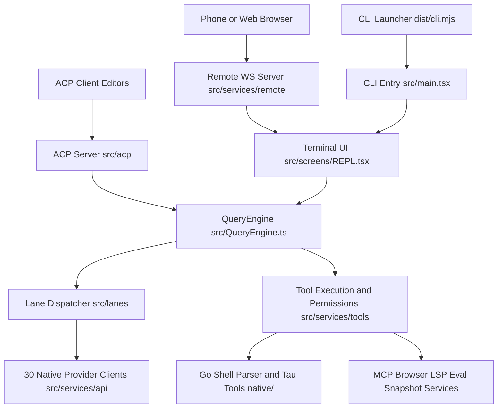
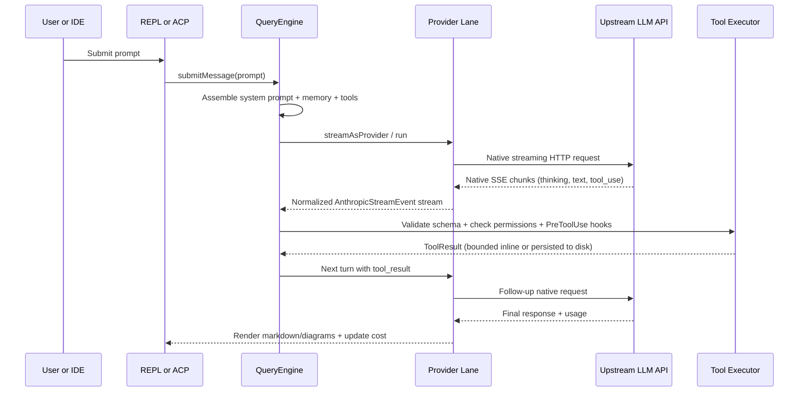

# System Architecture

## System Overview

Tau is a modular, multi-surface AI coding agent centered on a Node.js ESM monolith bundle (`dist/tau.mjs` built from `src/entrypoints/cli.tsx`, launched via self-verifying `dist/cli.mjs`) paired with optional native Go CLI helpers, a Rust N-API audio/WebRTC addon, IDE extensions, and a plugin/MCP ecosystem.

Architecturally, Tau separates **shared harness capabilities** (session state, permission gating, 50+ built-in tools, MCP client/server, hooks, skills, React/Ink terminal UI) from **model-family execution lanes** (`src/lanes/` and `src/services/api/providers/`). Every lane speaks its upstream provider API natively (Anthropic Messages, OpenAI Responses, Gemini generateContent/Code Assist, Chat Completions, Bedrock, Ollama, etc.) and normalizes streaming chunks into a single internal `AnthropicStreamEvent` intermediate representation consumed by `QueryEngine` and the Ink UI.

## Architecture Diagram

### Mermaid Diagram



### Text Alternative

```text
System Layers and Connections:
1. Entry Surfaces:
   - CLI Launcher (dist/cli.mjs) -> CLI Entry (src/main.tsx) -> Terminal UI (src/screens/REPL.tsx)
   - ACP Client Editors -> ACP Server (src/acp) -> QueryEngine (src/QueryEngine.ts)
   - Phone or Web Browser -> Remote WS Server (src/services/remote) -> Terminal UI / QueryEngine
2. Core Orchestration:
   - REPL drives QueryEngine (src/QueryEngine.ts) and query loop (src/query.ts)
   - QueryEngine dispatches model turns through Lane Dispatcher (src/lanes/dispatcher.ts)
   - Lane Dispatcher invokes 30 Native Provider Clients (src/lanes/* and src/services/api/providers/*)
3. Tooling & Runtime Subsystems:
   - QueryEngine invokes Tool Execution and Permissions (src/services/tools/toolExecution.ts)
   - Tool Execution calls Native Go Helpers (native/shell-parser, native/tau-tools), Rust Voice Addon (native/tau-voice), Browser CDP service, LSP client, MCP servers, Persistent Python Eval kernel, and Shadow-Git Snapshot store.
```

## Component Descriptions

### CLI Entrypoint and Bootstrap (`src/entrypoints/`, `src/main.tsx`, `src/setup.ts`, `src/bootstrap/`)
- **Purpose**: Process startup, runtime/dependency self-healing, CLI flag parsing (`commander`), and mode selection (interactive TUI, headless `--print`, `tau mcp`, `tau plugin`, `tau acp`, `tau update`).
- **Responsibilities**: Environment initialization, config migration (`src/migrations/`), signal handling, and bootstrapping session state.
- **Dependencies**: `commander`, `src/state/`, `src/cli/handlers/`.
- **Type**: Application

### Terminal UI and Custom Ink Renderer (`src/screens/`, `src/components/`, `src/ink/`, `src/hooks/`)
- **Purpose**: Renders the interactive terminal workspace, streaming markdown, terminal Mermaid diagrams, diffs, permission dialogs, and status bars.
- **Responsibilities**: Custom React 19 reconciler targeting ANSI terminals (`src/ink/`, including Sixel/Kitty graphics placement, mouse hit-testing, and flicker-free log updates) plus 420+ UI components.
- **Dependencies**: `react`, `react-reconciler`, `chalk`, `grok-mermaid`, `sixel`.
- **Type**: Application

### Query Engine and Agent Loop (`src/QueryEngine.ts`, `src/query.ts`, `src/tasks/`)
- **Purpose**: Manages multi-turn conversation state, context assembly, compaction, streaming model calls, tool loop iteration, and subagent/background tasks.
- **Responsibilities**: System prompt composition (`CLAUDE.md`, memory, skills, MCP instructions), automatic context compaction (`src/services/compact/`), cost/token tracking (`src/cost-tracker.ts`), and transcript persistence (`src/utils/sessionStorage.ts`).
- **Dependencies**: `src/lanes/`, `src/services/api/`, `src/services/tools/`, `src/memdir/`.
- **Type**: Application

### Native Multi-Provider Lanes and API Layer (`src/lanes/`, `src/services/api/`)
- **Purpose**: Executes native model calls across 30 LLM providers without proxy translation overhead.
- **Responsibilities**: Model-to-lane routing (`src/lanes/dispatcher.ts`), provider-specific tool schema sanitization, prompt cache affinity, reasoning-effort mapping, OAuth/API-key auth (`src/services/oauth/`), retry/rate-limit handling, and `AnthropicStreamEvent` normalization.
- **Dependencies**: `@anthropic-ai/sdk`, `@aws-sdk/client-bedrock-runtime`, `undici`, `axios`.
- **Type**: Client

### Tool Registry, Permission Engine, and Built-in Tools (`src/Tool.ts`, `src/tools/`, `src/services/tools/`, `src/utils/permissions/`)
- **Purpose**: Defines, validates, authorizes, and executes 50+ agent tools safely.
- **Responsibilities**: `zod` input validation, concurrency partitioning (read-only parallel vs mutating serial), Bash AST safety classification, hook interception (`PreToolUse` / `PostToolUse`), and large-output persistence (`src/utils/toolResultStorage.ts`).
- **Dependencies**: `zod`, `execa`, `chokidar`, `proper-lockfile`, `native/shell-parser`, `native/tau-tools`.
- **Type**: Application

### Integration Services (`src/services/mcp/`, `src/services/browser/`, `src/services/lsp/`, `src/services/remote/`, `src/bridge/`, `src/acp/`)
- **Purpose**: Connects the agent harness to external tools, browsers, language servers, IDEs, messaging channels, and mobile devices.
- **Responsibilities**: MCP stdio/HTTP/SSE client & server management, Chrome DevTools Protocol automation, LSP diagnostics, LAN/Cloudflare WebSocket remote control, WhatsApp pairing (`src/services/whatsapp/`), cloud bridge sessions, and ACP stdio server.
- **Dependencies**: `@modelcontextprotocol/sdk`, `@agentclientprotocol/sdk`, `ws`, `vscode-jsonrpc`, `@whiskeysockets/baileys`.
- **Type**: Application

### Native Sidecars and Addons (`native/shell-parser`, `native/tau-tools`, `native/tau-voice`)
- **Purpose**: Supplies compiled native binaries and N-API shared libraries for shell parsing, terminal utilities, and real-time voice.
- **Responsibilities**: Go POSIX/Bash syntax parsing, Go TUI/git/fuzzy helpers, and Rust Opus/WebRTC audio streaming.
- **Dependencies**: `mvdan.cc/sh/v3`, `charm.land/*`, `go-git`, `napi`, `tokio`, `webrtc`, `opus`.
- **Type**: Shared / Native

## Data Flow

### Mermaid Diagram



### Text Alternative

```text
Turn Execution Sequence:
1. User or IDE submits prompt to REPL (TUI) or ACP server.
2. REPL/ACP invokes QueryEngine.submitMessage(prompt).
3. QueryEngine loads system prompt sections, CLAUDE.md, auto-memory, active skills, and filtered tool definitions.
4. QueryEngine routes model ID via Lane Dispatcher to matching Provider Lane (Anthropic, Gemini, Codex, OpenAI-compat, etc.).
5. Provider Lane sends native HTTP/SSE request to Upstream LLM API and normalizes streaming chunks into AnthropicStreamEvent items.
6. When tool_use blocks arrive, Tool Executor validates input via Zod, evaluates permission rules + shell AST safety + PreToolUse hooks, executes the tool, runs PostToolUse hooks, and persists oversized outputs.
7. QueryEngine feeds tool_result blocks back into the Lane until the model finishes without pending tool calls.
8. UI renders streamed markdown/Mermaid diagrams and updates session transcript and token/cost counters.
```

## Integration Points

- **External APIs**:
  - **30 LLM Provider APIs** (`PROVIDERS.md`, `src/services/api/providers/`, `src/lanes/`): Anthropic, OpenAI, Google Gemini / Antigravity / Code Assist, AWS Bedrock, OpenRouter, Vercel AI Gateway, Requesty, Command Code, AgentRouter, Mistral, Moonshot, MiniMax, Alibaba DashScope, xAI, Meta, NVIDIA NIM, DeepSeek, GLM/BigModel, LM Studio, Ollama, Cline, GitHub Copilot, KiloCode, Kiro, OpenCode Zen/Go, Xiaomi MiMo, LXD, Fireworks AI, Cloudflare Workers AI.
  - **Web Search & Fetch Backends** (`src/tools/WebSearchTool/`, `src/tools/WebFetchTool/`): Built-in keyless search/MCP integration and optional Firecrawl API.
  - **Cloud Sandbox & Telemetry**: E2B code sandboxes (`e2b`), GrowthBook feature flags (`@growthbook/growthbook`), OpenTelemetry logs/metrics/traces (`@opentelemetry/*`).
- **Databases and Local Persistence**:
  - **Filesystem JSON/JSONL Stores** (`~/.claude/`, `.claude/`, `.tau/`): Settings (`settings.json`, `settings.local.json`), session transcripts (`src/utils/sessionStorage.ts`), per-project auto-memory (`src/memdir/`), persisted large tool outputs (`src/utils/toolResultStorage.ts`), and provider OAuth/API credentials (`src/utils/secureStorage/`).
  - **Shadow Git Repository** (`src/tools/SnapshotTool/`): Isolated git object store per workspace for working-tree snapshots and diffs.
  - **External Optional SQLite Index** (`.codegraph/`): Consumed via MCP (`codegraph`) when present in workspace.
- **Third-party Services and Local Processes**:
  - **Chromium / Chrome Browser** (`src/services/browser/`): Controlled locally via Chrome DevTools Protocol (CDP).
  - **Cloudflared Tunnel** (`src/services/remote/cloudflared.ts`): Spawns `cloudflared` quick HTTPS tunnels for `/remote global`.
  - **Language Servers** (`src/services/lsp/`): Spawns Pyright, `vtsls`, `bash-language-server`, `yaml-language-server`, `vscode-langservers-extracted`.
  - **WhatsApp Web Bridge** (`src/services/whatsapp/`): Optional session control over `@whiskeysockets/baileys`.

## Infrastructure Components

- **CDK Stacks**: None (Tau is a client-distributed CLI/desktop/IDE software package rather than an AWS CDK cloud service).
- **Deployment Model**: Published to npm as `@abdoknbgit/tau` (with deterministic `npm-shrinkwrap.json` staged via `release/production-shrinkwrap.mjs`), installed globally via `@abdoknbgit/tau-installer`, alongside 6 OS/CPU-specific `@abdoknbgit/tau-voice-*` optional npm packages. Local Go binaries (`shell-parser`, `tau-tools`) are compiled during build/postinstall via `scripts/build-native-*.mjs`.
- **Networking**: Outbound HTTPS/SSE to configured LLM APIs and MCP HTTP endpoints; optional local HTTP/WebSocket listener on `0.0.0.0:7777` (or ephemeral fallback port) for `/remote` with constant-time token authentication (`timingSafeEqual`) and optional `cloudflared` reverse tunnel; stdio JSON-RPC pipes for MCP and ACP.
