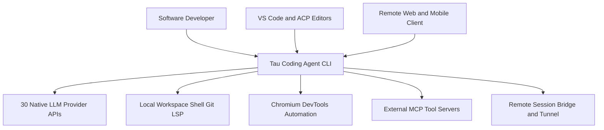

# Business Overview

## Business Context Diagram

### Mermaid Diagram



### Text Alternative

```text
Actors and External Systems around Tau Coding Agent CLI:
- Software Developer -> interacts directly via terminal TUI or headless CLI
- VS Code and ACP Editors -> connect via Agent Client Protocol (stdio JSON-RPC) or terminal companion
- Remote Web and Mobile Client -> pairs over LAN HTTP/WebSocket or Cloudflare HTTPS tunnel
- Tau Coding Agent CLI -> calls 30 Native LLM Provider APIs directly (no translation proxy)
- Tau Coding Agent CLI -> reads/edits Local Workspace, runs Shell commands, queries Git and LSP
- Tau Coding Agent CLI -> automates Chromium via DevTools Protocol
- Tau Coding Agent CLI -> connects to External MCP Tool Servers
- Tau Coding Agent CLI -> syncs shared sessions via Remote Session Bridge and Tunnel
```

## Business Description

- **Business Description**: Tau (`@abdoknbgit/tau`) is an open-source, multi-provider adaptive AI coding agent harness distributed primarily as a terminal CLI, with companion IDE extensions (VS Code ACP chat and terminal companion) and mobile/web remote session control. It lowers AI engineering token costs while maximizing output quality through direct native adapters for 30 LLM providers, context-bounded developer tools (signal-based file skeleton reading, ripgrep search with persisted outputs, persistent in-loop Python evaluation kernel, shadow-git workspace snapshots, real Chromium browser automation), background subagent orchestration, and Model Context Protocol (MCP) extensibility.
- **Business Transactions**:
  1. **Interactive Coding Turn Execution**: Developer submits a natural-language or slash-command prompt in the terminal REPL (`src/screens/REPL.tsx`); `QueryEngine` (`src/QueryEngine.ts`) routes the turn through a native provider lane (`src/lanes/`) or API client (`src/services/api/`), streams reasoning and text, executes approved tools against the workspace, and tracks token usage and cost (`src/cost-tracker.ts`).
  2. **Provider Authentication and Model Selection**: User authenticates against any of 30 supported model providers (`/login`, OAuth or API keys stored via secure config) and switches active models, reasoning effort ladders, and fast/cheap modes (`/models`, `/mode`).
  3. **Context-Efficient Workspace Inspection and Editing**: Agent invokes specialized tools (`src/tools/`) for file reads/writes/diffs, shell execution (guarded by Go AST shell parser), persistent Python kernel computation (`EvalTool`), browser inspection (`BrowserTool`), and shadow-git snapshots (`SnapshotTool`).
  4. **Multi-Agent Delegation**: Main agent spawns foreground or background subagents (`AgentTool`) optionally pinned to distinct providers/models or isolated git worktrees, and resumes or messages them via `SendMessageTool`.
  5. **Extensibility Lifecycle Management**: User installs, configures, and invokes MCP servers (`tau mcp`), plugins (`tau plugin`), skills (`SkillTool`), and lifecycle hooks (`src/utils/hooks.ts`).
  6. **Remote and Multi-Surface Collaboration**: User exposes a live session over LAN or Cloudflare tunnel (`/remote local|global` via `src/services/remote/`), connects an IDE via `tau acp` (`src/acp/`), or links cloud/bridge sessions (`src/bridge/`, `src/remote/`).
- **Business Dictionary**:
  - **Lane**: A model-family-native execution adapter (`src/lanes/`) that speaks a provider's native wire protocol, prompt caching, reasoning parameters, and tool schemas directly while normalizing output to `AnthropicStreamEvent` IR.
  - **Cheap Mode / Normal Mode**: Operating modes (`/mode`) controlling tool catalog size, prompt cache stability, and output byte caps.
  - **Shadow Snapshot**: Isolated per-project shadow git repository managed by `SnapshotTool` to save, diff, and restore working-tree states without touching `.git`.
  - **Persistent Eval Kernel**: Long-lived Python process (`EvalTool`) retaining variables across turns and bridging back into Tau tools (`tool.*`) to keep bulk data out of LLM context.
  - **ACP (Agent Client Protocol)**: JSON-RPC over stdio protocol (`src/acp/`) connecting code editors (VS Code, Zed, JetBrains) to the Tau agent engine.
  - **Subagent**: Autonomous child agent (`AgentTool`) with independent transcript, optional worktree isolation, and resumable state via `SendMessageTool`.
  - **Skill / Plugin**: Packaged prompt workflows, slash commands, hooks, and MCP configurations loaded from `.claude`, `.agents`, or `plugins/`.

## Component Level Business Descriptions

### Core CLI and Agent Harness (`@abdoknbgit/tau` - `src/`)
- **Purpose**: Delivers the primary developer-facing terminal coding assistant, headless automation CLI, MCP server/client, and ACP agent runtime.
- **Responsibilities**: Prompt processing, native multi-provider model execution, tool permission enforcement, TUI rendering, cost accounting, session persistence, subagent coordination, and remote WebSocket session sharing.

### Global CLI Installer (`@abdoknbgit/tau-installer` - `packages/tau-installer/`)
- **Purpose**: Provides zero-friction `npx` installation of Tau across macOS, Linux, and Windows.
- **Responsibilities**: Runs `npm install -g` with reviewed lifecycle scripts scoped strictly to the Tau installation and verifies runtime readiness.

### Native Go Helpers (`native/shell-parser/`, `native/tau-tools/`)
- **Purpose**: Accelerates latency-critical and security-critical terminal operations outside JavaScript bottlenecks.
- **Responsibilities**: Shell AST parsing for command safety classification (`shell-parser`), fuzzy file matching, syntax highlighting, terminal markdown rendering, git status summaries, and system telemetry (`tau-tools`).

### Native Voice Engine and Platform Packages (`native/tau-voice/`, `platform-packages/*`)
- **Purpose**: Enables real-time bidirectional voice interaction in the terminal without external browser dependencies.
- **Responsibilities**: Native OS audio capture/playback (WASAPI, CoreAudio, Linux), Opus encoding/decoding, and WebRTC transport packaged per OS/CPU target.

### VS Code Extensions (`editors/vscode/`, `tau-vscode/`)
- **Purpose**: Brings Tau into VS Code as both a native ACP chat panel (`editors/vscode/`) and a terminal-integrated IDE companion (`tau-vscode/`).
- **Responsibilities**: Editor diagnostics forwarding, inline diff views, active selection context sharing, and webview chat management.

### Bundled Plugins (`plugins/tau-git-memory/`)
- **Purpose**: Extends Tau with optional domain workflows via the plugin marketplace architecture.
- **Responsibilities**: Branch-aware Git-backed project memory storage, recall, and namespace visualization.
