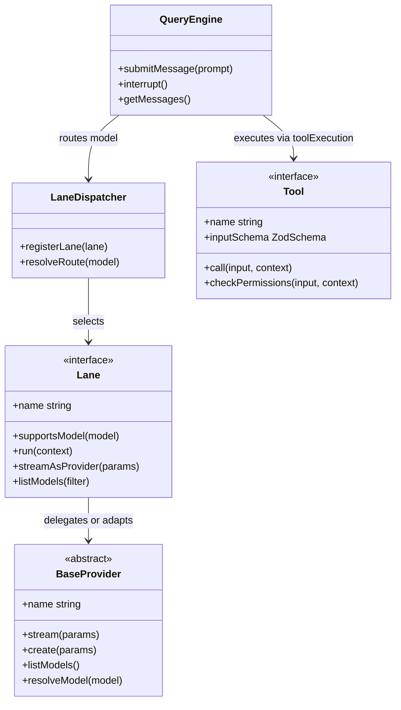

# Code Structure

## Build System

- **Type**: Node.js + `esbuild` primary bundler (`build.mjs`), optional Bun bundler (`build.ts`), npm workspaces (`packages/*`), Go modules (`native/shell-parser`, `native/tau-tools`), and Cargo workspace (`native/tau-voice`).
- **Configuration**:
  - `package.json`: Declares ESM package (`"type": "module"`), Node engine `>=20.19.0 <21.0.0 || >=22.12.0` (requiring `require(esm)` support), CLI bins `tau` and `claudex` -> `dist/cli.mjs`, runtime dependencies, and optional platform voice packages.
  - `tsconfig.json`: Targets `ESNext` with `moduleResolution: "bundler"`, `jsx: "react-jsx"`, `strict: true`, `allowImportingTsExtensions: true`, and path alias `src/* -> ./src/*`.
  - `build.mjs`: Bundles `./src/entrypoints/cli.tsx` into `./dist/tau.mjs` (ESM, `node20`), shims `bun:bundle` `feature()` calls to `false` for external builds, resolves `.js` imports to `.ts`/`.tsx`, injects CJS/ESM interop shims + `React.useEffectEvent` polyfill, generates the self-healing `./dist/cli.mjs` preflight launcher, and invokes `scripts/build-native-shell-parser.mjs` and `scripts/build-native-tools.mjs`.
  - `release/production-shrinkwrap.mjs`: Generates and verifies `npm-shrinkwrap.json` for reproducible global installs.

## Key Classes/Modules

### Mermaid Diagram



### Text Alternative

```text
Core Module Relationships:
- QueryEngine (src/QueryEngine.ts) orchestrates turns, routing model requests via LaneDispatcher (src/lanes/dispatcher.ts) and executing tool calls via Tool definitions (src/Tool.ts).
- LaneDispatcher selects a registered Lane implementation (src/lanes/types.ts) matching the model family.
- Lane implementations (gemini, codex, openai-compat, cursor, cline, kiro, qwen, kilo, claude) either run native protocol loops directly or delegate through BaseProvider subclasses (src/services/api/providers/base_provider.ts).
- Every built-in tool is constructed via buildTool() (src/Tool.ts), enforcing fail-closed defaults for permissions, concurrency, and read-only metadata.
```

### Existing Files Inventory

Workspace contains **3,173** source/config/test files (excluding `node_modules`, `dist`, `.git`, `.codegraph`, `aidlc-docs`), including **2,821** files under `src/`. Key files and module directories for brownfield modifications:

- `src/entrypoints/cli.tsx` & `src/entrypoints/init.ts` - Top-level CLI bootstrap, fast-path subcommands, and runtime initialization.
- `src/entrypoints/mcp.ts` & `src/entrypoints/agentSdkTypes.ts` - MCP server entrypoint and SDK message/control protocol types.
- `src/main.tsx` & `src/setup.ts` - Commander CLI definition, flag parsing, onboarding, and interactive/headless dispatch.
- `src/replLauncher.tsx` & `src/screens/REPL.tsx` - Main interactive TUI screen, turn lifecycle, dialogs, and input handling.
- `src/QueryEngine.ts` & `src/query.ts` - Core turn loop, prompt construction, streaming consumption, compaction triggers, and usage accounting.
- `src/Tool.ts` & `src/tools.ts` - `Tool` interface, `buildTool()` factory with fail-closed defaults, and central tool registry assembly.
- `src/commands.ts` & `src/commands/*` (276 files) - Slash command definitions (`/models`, `/login`, `/mode`, `/tools`, `/config`, `/remote`, `/commit`, `/compact`, `/statistics`, `/report`, etc.).
- `src/lanes/*` (241 files) - Native model-family lanes: `dispatcher.ts`, `types.ts`, `bridge.ts`, `openai-compat/` (85 files), `gemini/` (47 files), `shared/` (38 files), `codex/` (18 files), `cursor/` (11 files), `cline/` (10 files), `kiro/` (8 files), `qwen/` (8 files), `kilo/` (7 files), `claude/` (3 files).
- `src/services/api/*` (97 files) - Anthropic client (`claude.ts`), `providerRouting.ts`, retry/backoff (`withRetry.ts`), prompt caching, and `providers/*` (`BaseProvider` and 20+ concrete provider adapters).
- `src/services/tools/*` (10 files) - `toolExecution.ts` orchestrating parallel read-only vs serial mutating tool calls, error classification, and hook execution.
- `src/services/mcp/*` (30 files) - MCP stdio/SSE/HTTP client connections, tool/resource discovery, OAuth, and approval dialogs.
- `src/services/browser/*` (30 files) - Chromium CDP client, DOM observation (`@N` ref tagging), `measure`, `extract`, flow recording/replay.
- `src/services/remote/*` (15 files) - Local/tunnel HTTP+WebSocket server (`server.ts`), embedded web UI (`webui.ts`), QR pairing, interactive remote prompts, `cloudflared` integration.
- `src/services/compact/*` (14 files) - Automatic and manual conversation compaction and context window budgeting.
- `src/services/lsp/*` (11 files) - Optional background LSP server lifecycle and diagnostic collection.
- `src/tools/*` (282 files across 50 tool directories) - `BashTool`, `AgentTool`, `EvalTool`, `FileReadTool`, `FileEditTool`, `FileWriteTool`, `GrepTool`, `GlobTool`, `BrowserTool`, `SnapshotTool`, `MCPTool`, `SkillTool`, `Task*Tool`, `AskUserQuestionTool`, `CodebaseRetrievalTool`, `ProjectWorkflowTool`, `RepoContextScoutTool`, etc.
- `src/components/*` (424 files) & `src/hooks/*` (108 files) - Terminal React UI components (PromptInput, ModelPicker, Permission dialogs, Mascot/Buddy, Diff views) and custom React hooks.
- `src/ink/*` (103 files) - Custom terminal React renderer, Yoga/box layout, ANSI tokenizer, Sixel graphics placement, mouse hit-testing, and theme handling.
- `src/utils/*` (836 files) - Core utilities: `model/` (86 files), `plugins/` (69 files), `hooks/` (26 files), `permissions/` (26 files), `bash/` (26 files), `swarm/` (21 files), `settings/` (20 files), `shell/` (17 files), `sessionStorage.ts`, `messages.ts`, `toolResultStorage.ts`.
- `src/acp/*` (5 files) - Agent Client Protocol stdio server (`index.ts`, `agent.ts`, `tauBackend.ts`, `convert.ts`).
- `src/bridge/*` (31 files) & `src/remote/*` (4 files) - Cloud/remote session bridge transports, JWT/work-secret handling, and WebSocket session syncing.
- `src/memdir/*` (9 files) - Persistent file-based auto-memory (`MEMORY.md` index and typed memory files).
- `src/voice/*` (11 files) & `native/tau-voice/*` (23 files) - Voice session integration and Rust N-API Opus/WebRTC engine.
- `native/shell-parser/*` (3 files) & `native/tau-tools/*` (9 files) - Go native helper binaries.
- `packages/tau-installer/*` (5 files) - Standalone npm global installer package.
- `editors/vscode/*` (14 files) & `tau-vscode/*` (20 files) - ACP chat VS Code extension and IDE companion VS Code extension.
- `plugins/tau-git-memory/*` (12 files) - Bundled git-backed memory plugin.
- `scripts/*` (19 files) & `release/*` (7 files) - Build, postinstall verification, native compilation, and shrinkwrap/release scripts.
- `test/*` (170 files) - Integration and subsystem tests (`node:test` and `bun:test`).

## Design Patterns

### Native Lane + Normalized Event IR Pattern
- **Location**: `src/lanes/types.ts`, `src/lanes/dispatcher.ts`, `src/services/api/providers/base_provider.ts`
- **Purpose**: Avoids lossy request/response proxy translation across heterogeneous LLM APIs while keeping UI and tool execution completely model-agnostic.
- **Implementation**: Each `Lane` constructs native upstream payloads (preserving provider-specific caching, reasoning effort, and tool schemas) and yields `AnthropicStreamEvent` objects via `AsyncGenerator`.

### Fail-Closed Factory Pattern (`buildTool`)
- **Location**: `src/Tool.ts:750-825`
- **Purpose**: Guarantees every tool has safe security and concurrency defaults without repetitive boilerplate across 50+ tools.
- **Implementation**: `buildTool(def)` merges `TOOL_DEFAULTS` (`isConcurrencySafe: false`, `isReadOnly: false`, `isDestructive: false`) with compile-time type preservation (`BuiltTool<D>`).

### Self-Healing Preflight Launcher Pattern
- **Location**: `build.mjs:365-496`, `scripts/verify-deps.mjs`
- **Purpose**: Protects end users against broken global npm installs (blocked lifecycle scripts or incompatible Node.js versions).
- **Implementation**: Dependency-free `dist/cli.mjs` checks Node `require(esm)` compatibility, re-execs a compatible Node binary if needed, verifies `.tau-lifecycle-complete.json` and `node_modules`, repairs missing deps, then dynamically imports `dist/tau.mjs`.

### Context-Bounded Persisted Tool Output Pattern
- **Location**: `src/utils/toolResultStorage.ts`, `src/tools/ToolOutputRetrieveTool/`, `src/tools/EvalTool/`
- **Purpose**: Prevents large tool outputs or multi-file computations from exhausting LLM context windows and invalidating prompt caches.
- **Implementation**: Oversized outputs are written to disk and replaced with compact previews + `ToolOutputRetrieve` handles; bulk computation runs inside a stateful Python kernel (`EvalTool`).

## Critical Dependencies

### `@anthropic-ai/sdk` (`^0.50.1`)
- **Usage**: `src/services/api/claude.ts`, `src/Tool.ts`, `src/QueryEngine.ts`
- **Purpose**: Native Anthropic Messages streaming client and canonical content-block / stream-event TypeScript types used across the agent loop.

### `react` (`~19.1.0`) & `react-reconciler` (`~0.32.0`)
- **Usage**: `src/ink/`, `src/screens/`, `src/components/`
- **Purpose**: Declarative component model and custom terminal reconciler powering the interactive CLI UI.

### `@modelcontextprotocol/sdk` (`^1.12.1`) & `@agentclientprotocol/sdk` (`^0.26.0`)
- **Usage**: `src/services/mcp/`, `src/acp/`
- **Purpose**: Standard MCP tool/resource client-server communication and ACP editor integration over JSON-RPC.

### `zod` (`^3.25.0`)
- **Usage**: `src/Tool.ts`, `src/tools/*`, `src/schemas/`, `src/entrypoints/sdk/`
- **Purpose**: Runtime input validation and JSON Schema generation for all tool definitions, settings, and protocol payloads.

### `esbuild` (`^0.28.0`)
- **Usage**: `build.mjs`, `editors/vscode/esbuild.mjs`
- **Purpose**: Fast TypeScript/TSX bundling into distributable Node ESM artifacts without requiring Bun on contributor machines.
