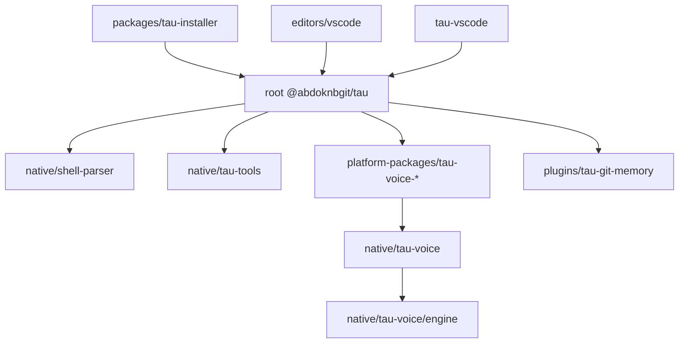

# Dependencies

## Internal Dependencies

### Mermaid Diagram



### Text Alternative

```text
Internal Package Dependency Graph:
- @abdoknbgit/tau-installer -> installs @abdoknbgit/tau globally
- editors/vscode (ACP extension) -> spawns `tau acp` from @abdoknbgit/tau
- tau-vscode (companion extension) -> launches `tau`/`claudex` CLI in VS Code terminal
- @abdoknbgit/tau -> invokes compiled Go binaries from native/shell-parser and native/tau-tools
- @abdoknbgit/tau -> optionally loads OS/CPU package @abdoknbgit/tau-voice-*
- @abdoknbgit/tau-voice-* -> packages cdylib built from native/tau-voice
- native/tau-voice -> depends on path crate pi-voice (native/tau-voice/engine)
- @abdoknbgit/tau -> discovers and loads bundled plugin plugins/tau-git-memory
```

### `@abdoknbgit/tau-installer` depends on `@abdoknbgit/tau`
- **Type**: Runtime / Distribution
- **Reason**: Wraps `npm install -g @abdoknbgit/tau` so lifecycle scripts (`preinstall`, `postinstall`) run safely for Tau without permanently altering user npm config.

### `@abdoknbgit/tau` depends on `native/shell-parser` & `native/tau-tools`
- **Type**: Build / Runtime
- **Reason**: `build.mjs` compiles both Go modules; `BashTool` and native search/render utilities spawn these binaries at runtime with JS fallbacks where supported.

### `@abdoknbgit/tau` depends on `@abdoknbgit/tau-voice-*` (`native/tau-voice` -> `pi-voice`)
- **Type**: Optional Runtime / Build
- **Reason**: `package.json` declares the 6 OS/CPU `@abdoknbgit/tau-voice-*` packages under `optionalDependencies` (`1.0.0`), built from `native/tau-voice` (`Cargo.toml`) which links `pi-voice` (`native/tau-voice/engine/Cargo.toml`).

### `editors/vscode` & `tau-vscode` depend on `@abdoknbgit/tau`
- **Type**: Runtime
- **Reason**: `editors/vscode` spawns `tau acp` over stdio JSON-RPC; `tau-vscode` invokes `tau` / `claudex` in integrated terminals and exposes IDE state.

## External Dependencies

### LLM, Protocol, and Agent SDKs
- **`@anthropic-ai/sdk`** (`^0.50.1`, MIT) - Anthropic Messages streaming client and core TypeScript message/event types.
- **`@aws-sdk/client-bedrock-runtime`** (`^3.700.0`, Apache-2.0) - AWS Bedrock Converse/InvokeModel streaming runtime.
- **`@modelcontextprotocol/sdk`** (`^1.12.1`, MIT) - MCP client and server protocol implementation.
- **`@agentclientprotocol/sdk`** (`^0.26.0`, Apache-2.0/MIT) - ACP JSON-RPC stream bindings for IDE integration.
- **`google-auth-library`** (`^9.15.1`, Apache-2.0, bundled via `build.mjs`) - Google Cloud / Vertex / Gemini Code Assist authentication.
- **`e2b`** (`^2.10.0`, Apache-2.0, bundled via `build.mjs`) - Remote cloud sandbox execution SDK.

### Terminal UI, Rendering, and Graphics
- **`react`** (`~19.1.0`, MIT) & **`react-reconciler`** (`~0.32.0`, MIT) - Component model and custom reconciler backing `src/ink/`.
- **`chalk`** (`^5.4.1`, MIT), **`wrap-ansi`** (`^9.0.0`, MIT), **`strip-ansi`** (`^7.1.0`, MIT), **`@alcalzone/ansi-tokenize`** (`^0.1.3`, MIT) - ANSI styling, tokenization, and line wrapping.
- **`marked`** (`^15.0.7`, MIT), **`highlight.js`** (`^11.11.1`, BSD-3-Clause), **`turndown`** (`^7.2.4`, MIT) - Markdown/HTML parsing, syntax highlighting, and conversion.
- **`grok-mermaid`** (`0.2.3`, MIT), **`sixel`** (`^0.16.0`, MIT), **`sharp`** (`^0.34.5`, Apache-2.0), **`qrcode`** (`^1.5.4`, MIT) - Terminal diagram rendering, Sixel terminal graphics, image resizing, and QR pairing codes.

### Workspace, Parsing, Networking, and System Utilities
- **`zod`** (`^3.25.0`, MIT) & **`ajv`** (`^8.17.1`, MIT) - Schema validation for tools, settings, and MCP/JSON-RPC payloads.
- **`web-tree-sitter`** (`^0.26.9`, MIT) & **`@vscode/tree-sitter-wasm`** (`^0.3.1`, MIT) - AST code skeletons and symbol outlines without LSP overhead.
- **`execa`** (`^9.5.2`, MIT), **`shell-quote`** (`^1.8.2`, MIT), **`tree-kill`** (`^1.2.2`, MIT), **`node-pty`** (`^1.1.0`, MIT, optional) - Subprocess/PTY execution and process-tree termination.
- **`chokidar`** (`^4.0.3`, MIT), **`ignore`** (`7.0.5`, MIT), **`picomatch`** (`^4.0.2`, MIT), **`proper-lockfile`** (`^4.1.2`, MIT) - File watching, `.gitignore` filtering, glob matching, and cross-process file locking.
- **`undici`** (`^7.3.0`, MIT), **`axios`** (`^1.7.9`, MIT), **`ws`** (`^8.18.0`, MIT), **`https-proxy-agent`** (`^7.0.6`, MIT) - HTTP/SSE streaming, proxy support, and WebSocket servers/clients.
- **`pino`** (`^9.0.0`, MIT) & **`@opentelemetry/*`** (`^1.9.0` / `^2.0.0`, Apache-2.0) - Structured logging and telemetry.
- **`@whiskeysockets/baileys`** (`7.0.0-rc12`, MIT) - Optional WhatsApp session bridge.
- **`pdfkit`** (`^0.18.0`, MIT) & **`xss`** (`^1.0.15`, MIT) - PDF generation and HTML sanitization.

### Native Go and Rust Dependencies
- **`mvdan.cc/sh/v3`** (`v3.11.0`, BSD-3-Clause) - Go POSIX/Bash shell parser (`native/shell-parser`).
- **`charm.land/bubbletea/v2`**, **`glamour/v2`**, **`lipgloss/v2`**, **`chroma/v2`**, **`go-git/v5`**, **`gopsutil/v4`** (MIT / BSD / Apache-2.0) - Go TUI, highlighting, git, and host metrics (`native/tau-tools`).
- **`napi`** (`3.12.2`, MIT), **`tokio`** (`1.53.1`, MIT), **`webrtc`** (`0.17.2`, MIT/Apache-2.0), **`opus`** (`0.3.1`, MIT) - Rust async N-API voice/WebRTC stack (`native/tau-voice`).
